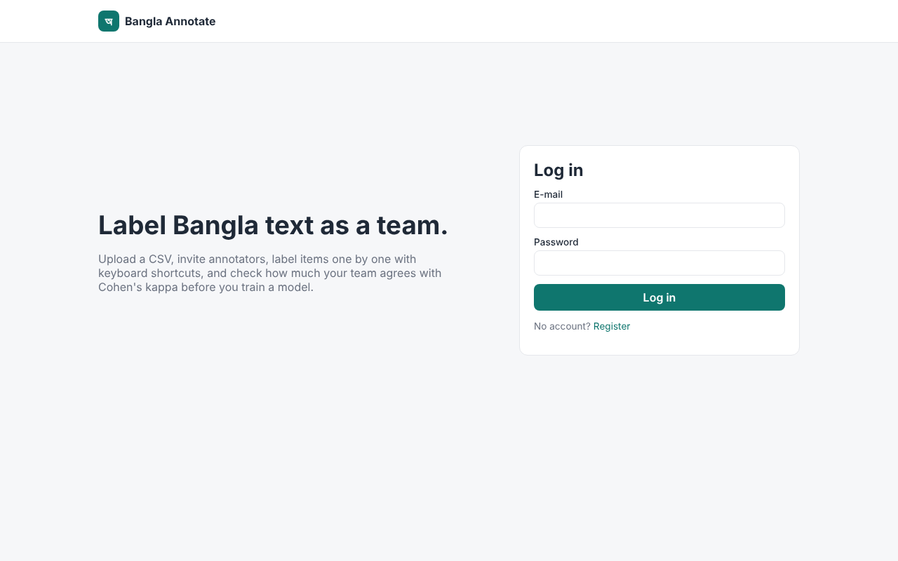

# Bangla Annotate

A full-stack web app for labelling Bangla text datasets as a team, and for checking how
consistent the labels are before the data is used to train a model.

I built it after working on data collection for my undergraduate thesis on Bangla fake news
detection. Collecting and labelling text by hand in spreadsheets was slow, two people often
labelled the same row, and there was no easy way to see whether the labels agreed.



## Features

- **Projects with custom labels**: an admin creates a project with 2–9 labels (for example
  `real`, `fake`, `unsure`) and chooses how many people must label each item.
- **CSV upload**: upload up to 5,000 rows at a time. Works with Excel's UTF-8 CSV files.
- **Fast labelling screen**: one item at a time in a clear Bangla font, keyboard shortcuts
  (keys 1–9), and a counter of what is left. Nobody gets the same item twice.
- **Team management**: add annotators by e-mail, remove them, see how much each person did.
- **Agreement check**: Cohen's kappa and raw agreement for every pair of annotators, with the
  usual Landis & Koch wording (fair, moderate, substantial ...).
- **Export**: CSV or JSON with every annotator's label and a majority-vote final label.
- **Security**: passwords hashed with bcrypt, JWT authentication, rate-limited login,
  Helmet headers, CORS limited to the frontend address, owner-only admin routes.

## Tech stack

| Part | Technology |
| --- | --- |
| Frontend | React 18, React Router, Vite, plain CSS |
| Backend | Node.js, Express 5, Mongoose |
| Database | MongoDB Atlas |
| Auth | JWT, bcrypt |
| Tests | Node's built-in test runner |
| Hosting | Vercel (frontend), Render (backend) |

## Project structure

```
client/   React app (pages: login, projects, labelling, project dashboard)
server/   Express API, Mongoose models, agreement and CSV helpers, tests
sample-data.csv   a small file to try the upload
```

## API overview

| Method | Path | Who |
| --- | --- | --- |
| POST | `/api/auth/register`, `/api/auth/login` | everyone |
| GET | `/api/projects` | logged in |
| POST | `/api/projects` | admin |
| POST | `/api/projects/:id/items` (CSV upload) | project owner |
| POST / DELETE | `/api/projects/:id/members` | project owner |
| GET | `/api/projects/:id/next` | members |
| POST | `/api/projects/:id/annotations` | members |
| GET | `/api/projects/:id/stats`, `/api/projects/:id/export` | project owner |

## Run it locally

You need Node.js 20+ and a free MongoDB Atlas cluster.

```bash
# backend
cd server
cp .env.example .env      # fill in MONGODB_URI, JWT_SECRET and ADMIN_EMAIL
npm install
npm run seed              # optional: demo admin, two annotators and a sample project
npm run dev               # http://localhost:5000

# frontend (second terminal)
cd client
cp .env.example .env      # VITE_API_URL=http://localhost:5000
npm install
npm run dev               # http://localhost:5173
```

The account registered with `ADMIN_EMAIL` becomes the admin. After `npm run seed` you can log in
with that e-mail, `rahim@example.com` or `karim@example.com`, password `demo12345`.

Run the tests with `cd server && npm test`.

## Ideas for later

- Let annotators skip an item and come back to it
- Fleiss' kappa for three or more annotators per item
- Highlight disagreements so the admin can decide the final label
